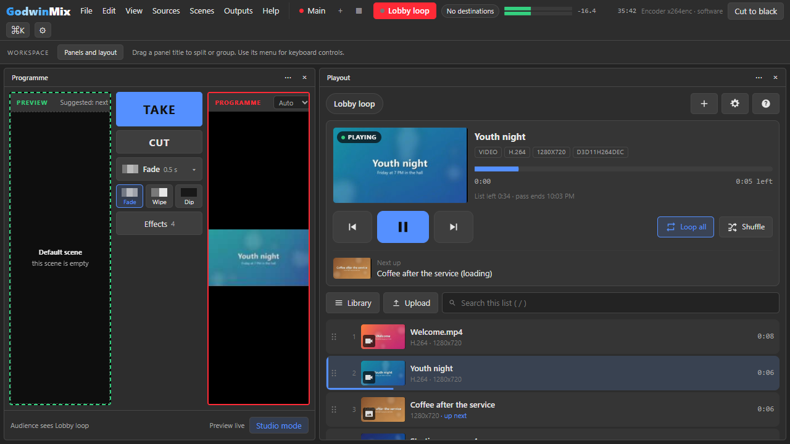
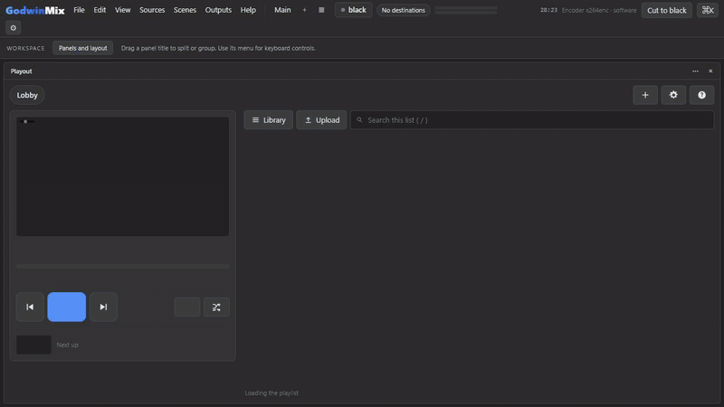
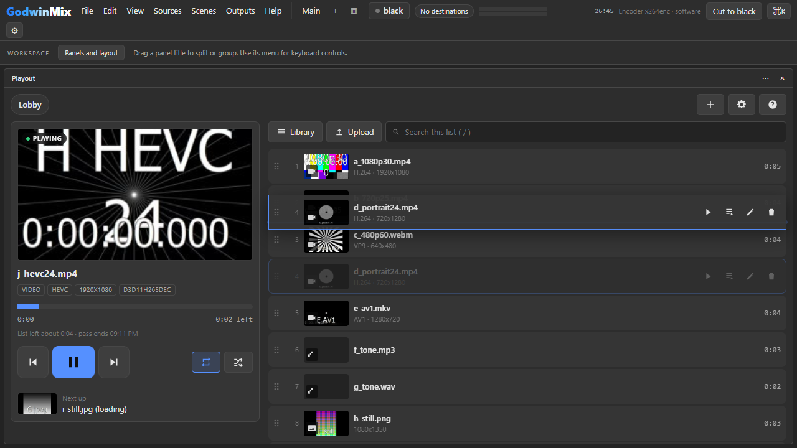
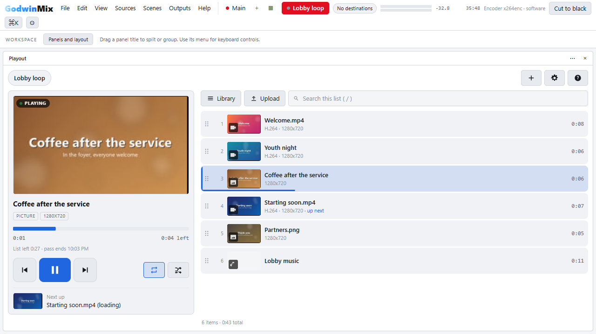
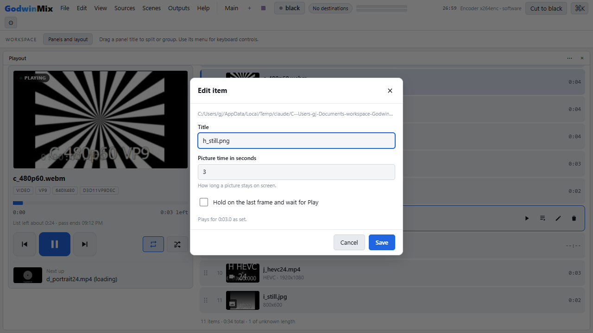

# Playout for GodwinMix

A playlist as one source. Put video, sound and picture files in a list and they
play one after another on a single source, with no black frame, no gap in the
sound and no jump in the timestamps when one item hands over to the next. Mixed
sizes, frame rates and codecs come out at the show's own canvas.





## What it does

* Plays MP4, MOV, M4V, MKV and WebM video, MP3, WAV, FLAC, Ogg, AIFF and M4A
  sound, and PNG, JPEG, WebP, GIF, BMP and TIFF pictures, in any mix, in one
  list.
* Opens the next item five seconds before the current one ends, so it has
  pictures and sound waiting when the moment comes. A skip waits for the next
  item's first picture rather than showing black.
* Loops the whole list or one item, or stops at the end on black or on the
  last frame. Shuffles, with a new order each time round.
* Cue an item to play next, play one now, skip, go back, pause, seek.
* An in and an out point per item, a time per picture, and a hold that stops on
  an item's last frame until you press play.
* A file that is missing or will not decode is skipped, named in the panel and
  in the mixer's log, and the list plays on.
* While a sound file plays, the picture is black or holds what played before.
* Several playlists, each its own source, saved with the project.

## The panel



The panel lives inside the mixer. It shows what is playing with a progress bar,
the time left in the item and in the whole list and the clock time the list
ends, what plays next, and every item with a thumbnail and its length. Drag
items to reorder them, double click to play one now, and add files from the
mixer's media library, with the file picker, or by dropping them on the panel.
It follows the mixer's light and dark themes and works on a phone.





Keyboard, while the panel has focus: Space play and pause, N or Right next, P
or Left previous, Enter play the selected item, C cue it, Delete remove it,
Alt with Up or Down move it, L cycle the loop, S shuffle, / search, ? help.

## Install

From the mixer: **Plugins**, find **Playout**, **Install**. Or from a shell:

```sh
gmx plugin add playout
```

It needs GodwinMix 0.3.13 or newer. On Windows and macOS it uses the GStreamer
the desktop app carries; on Linux, the system's.

Then add a playlist from the panel (**+**), or:

```sh
gmx ctl source add lobby --type playout/playlist
```

## Control it from anywhere

The list is the source's params, so `source.set` changes it, the project file
keeps it, and an agent edits it the way the panel does. Playback is driven with
tools, each taking the source id:

| Tool | Does |
|---|---|
| `state` | what is on, where it is, time left in the item and the list, what is next, every item with its length and any error |
| `play`, `pause` | resume, continue after a hold, start again after the list ended; pause on the picture |
| `next`, `previous` | skip now; back to the start, or to the item before in the first three seconds |
| `play_item`, `cue` | play an item now; play it next, once |
| `seek` | move within the current item |
| `thumbnail` | a small JPEG of an item, for a list |

```sh
curl -s -X POST http://127.0.0.1:8080/api/v1/tool/call \
  -H "Authorization: Bearer $TOKEN" -H 'content-type: application/json' \
  -d '{"name": "playout/next", "source": "lobby", "arguments": {"source": "lobby"}}'

gmx tool gmx_playout_state '{"source": "lobby"}'
```

`skills/playlist/SKILL.md` is what an agent reads before it uses these.

## What is Rust and what is GStreamer

As much as possible is Rust, and GStreamer does the one job Rust has no mature
answer for, which is decoding video with the computer's own hardware.

| Part | Done by |
|---|---|
| the list, the order, loop, shuffle, cue | Rust |
| the clock, pacing, timestamps, opening the next item early | Rust |
| reading MP4 and QuickTime | Rust, a reader in this repository |
| reading Matroska and WebM | Rust, `matroska-demuxer` |
| decoding AAC, MP3, FLAC, Vorbis, WAV and AIFF | Rust, `symphonia` |
| resampling to 48 kHz | Rust, `rubato` |
| decoding pictures | Rust, `image` |
| scaling and fitting to the canvas | Rust, `fast_image_resize` |
| the protocol and the Matroska stream to the mixer | Rust, `godwinmix-sdk` |
| decoding H.264, HEVC, AV1, VP9 and VP8 | GStreamer: the platform's decoder |
| decoding Opus | GStreamer: libopus |

There is no FFmpeg anywhere, and no `decodebin` that could fall back to it. The
decoder is chosen by name from a short list, hardware first: Direct3D 11 and 12
on Windows, VideoToolbox on macOS, VA and V4L2 on Linux, then openh264, dav1d,
libvpx and libde265. A codec with none of them on the machine is skipped with a
sentence saying what to install.

Each crate is here for one job nothing smaller does: `symphonia` decodes sound,
`rubato` resamples it, `image` reads pictures, `fast_image_resize` scales with
SIMD on x86 and ARM, `matroska-demuxer` reads Matroska. MP4 is read by about seven
hundred lines in `src/media/mp4/`, tests included, rather than a crate.

## Measured

On a Windows laptop (Intel Core Ultra, GStreamer 1.28.6), with the plugin
playing into a 1920x1080 at 30 fps show:

* **No gaps.** A list of four video files at 1080p30, 720p25, 480p60 and
  720x1280 at 24 fps, each with a steady tone, and a WAV file, played round and
  round and recorded off the mixer's programme for 48.8 seconds: every one of
  the 1,466 frames was exactly one frame after the one before, and there was
  not a single silent 5 ms window in the sound across 13 item changes. The
  only black frames were the WAV file's, which has no picture.
  `examples/gaps.rs` does the measuring; `dev/capture.py` runs the engine
  without a mixer.
* **A long mixed run.** The test list of every kind this plays (H.264,
  HEVC, AV1 with Opus, VP9 with Vorbis, MP3, WAV, PNG, JPEG, a portrait clip
  with no sound and a missing file) went round for 10 minutes 50 seconds on
  the programme: 19,495 frames, not one off its step, every item exactly as
  long as it is. The only silence was where an item has no sound; between two
  lossy files there are 5 to 15 ms that the files themselves carry, which is
  the AAC and MP3 encoders' own padding.
* **CPU**, measured on the engine with no mixer, sending 1920x1080 at 30 fps:

  | Playing | One core |
  |---|---|
  | a picture | 7 percent: the pipe, 93 MB a second of raw video |
  | 1080p H.264, decoded on the GPU | 16 percent |
  | 1080p H.264, decoded in software (openh264) | 38 percent |
  | 720p H.264 on a 720p show | 9 percent |
  | 720p H.264 scaled up to 1080p | 39 percent, most of it the scaling |

  Scaling costs about 7 ms a frame for 720p to 1080p and 1 ms when the file
  already matches the show (`examples/scalebench.rs`), so files made at the
  show's size are the cheap ones.

## Where things are

| Path | What it is |
|---|---|
| `src/engine/` | the output thread: one picture and its sound per tick, item changes |
| `src/item/` | one item opening, decoding and waiting in queues for the output |
| `src/media/` | the readers, decoders, resampler and scaler |
| `src/queue.rs` | the play order, as plain logic with tests |
| `src/tools.rs`, `src/report.rs` | the tools and the `state` answer |
| `launch/` | `playout`, which finds GStreamer on macOS and Linux and becomes the engine |
| `ui/` | the panel, plain JavaScript modules with no build step |
| `examples/` | `item`, `demux` and `gaps`, for finding out what a file does |

## Build and test

```sh
cargo build --release
cargo test --release              # unit tests and the offline transcript
gmx plugin test .                 # the mixer's conformance harness
python dev/capture.py --seconds 20 a.mp4 b.mkv c.png   # run with no mixer
```

You need Rust and GStreamer with its development files, as for GodwinMix
itself. The binaries go in `bin/` for `gmx plugin add .`; the release workflow
builds them for Windows, macOS (Apple silicon and Intel) and Linux (x86_64 and
ARM64).

## Not yet

* Fragmented MP4, as some screen recorders write, does not play yet. Remux it
  to a plain MP4.
* The media reaches the mixer as Matroska on a pipe, on every platform. The
  zero copy `unixfd` transport would save the 8 percent above on macOS and
  Linux, and has not been measured there yet.
* Only the first video and the first sound track of a file are played.

## License

Apache-2.0.
